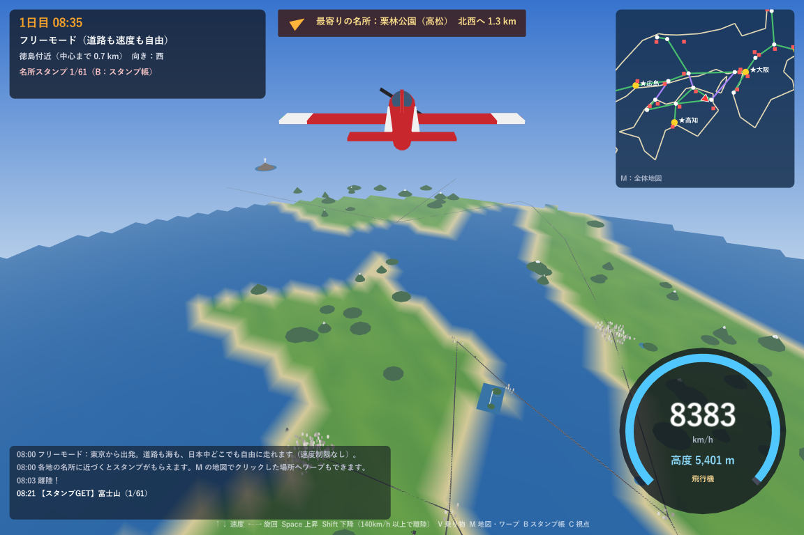
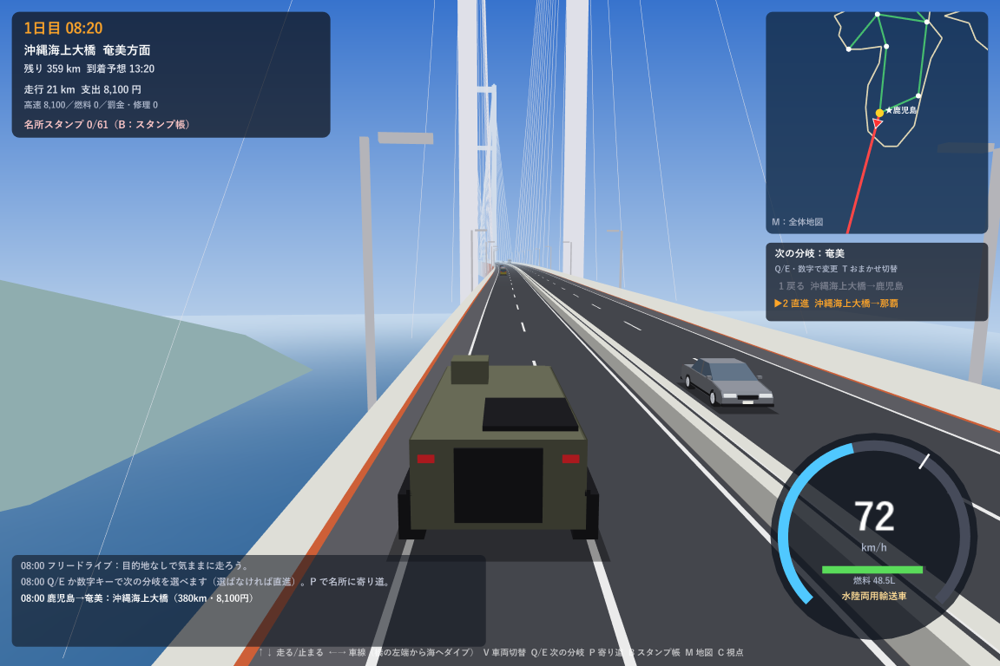
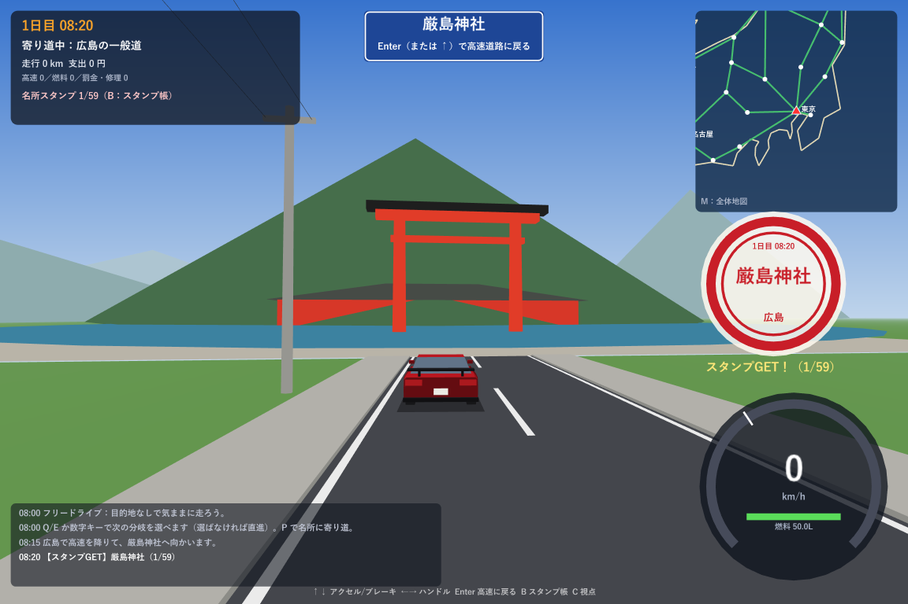

# 日本一周ドライブ 3D

日本の高速道路を走って日本一周したり、道路に関係なく日本中を自由に走り回ったりできる 3D ドライブゲームです（Windows 用・C#）。



## 遊び方

- **日本一周モード**：★の10都市を巡って東京へ戻る。分岐はおまかせで直進、Q/E で次の分岐を予約。高速料金・燃料・スピード違反もあり。
- **フリーモード**：道路も海も関係なく、日本中どこでも走れる。F4 で乗り物ごとの速度上限を切り替えられる。地図をクリックしてワープも。
- **名所スタンプラリー**：日本各地や周辺地域の名所（東京タワー、名古屋城、厳島神社、富士山、首里城…）を3Dで再現。近くまで行くとスタンプがもらえる。フリーモードでは名所の壁や柱に衝突し、鳥居の柱の間も走れる。橋の名所は周辺都市につながる道路上にあり、道路をそのまま走ってスタンプを集められる。
- **乗り物**：スポーツカー、戦車（砲撃できる）、水陸両用輸送車、西部劇風の馬（カウボーイ騎乗）、飛脚、ヘリコプター、飛行機、通常爆弾を投下できるジェット戦闘機、月へ行ける宇宙船（フリーモード）。
- **月面エリア**：フリーモードで宇宙船に乗り、高度3万mを突破すると月へ移動できる。静かの海ベースを中心とした半径900mの探索エリアには、クレーター、地球展望丘、南部観測所がある。M で月面地図を開ける。R を続けて2回押すと、どの乗り物でもそのまま地球へ帰還できる。宇宙船なら高度5,000mまで上昇しても帰還できる。往復とも約4秒の飛行アニメーションが流れる。
- **沖縄海上大橋**：鹿児島〜奄美〜那覇をつなぐ全長680kmの超巨大橋（ゲームオリジナル）。
- 効果音・エンジン音・BGM はすべてプログラムで合成。タイトル画面の右上にある設定アイコン（歯車）または S キーから音量・速度上限・初期シフトモードを調整でき、記録とともに自動でセーブ。

初めて遊ぶと、走行画面にモード別の操作ヒントが表示されます。スタンプ帳（B）の下にある「近くの未取得の名所」から名所を選ぶと、地図にその場所が表示されます。

日本一周モードの途中経過は走行中に自動保存され、N を2回押してタイトルに戻るときや、ウィンドウを閉じるときにも保存されます。タイトル画面の「日本一周を続ける」（3キー）で再開できます。一般道へ寄り道している場合は、寄り道の出発地点だった都市から再開します。保存に失敗すると画面に通知が出て、次の自動保存で再試行します。通常のセーブを読み込めない場合は、直前のバックアップから読み込みます。

東京では東京タワー、浅草寺、野獣邸の3か所で名所スタンプを集められます。
野獣邸の外観は参考画像をもとに、シャッター、屋上の手すり、玄関階段、門柱と植え込みを基本図形で表現しています。

| 沖縄海上大橋 | 名所スタンプ |
|---|---|
|  |  |

主な操作：↑↓ アクセル／ブレーキ、←→ ハンドル、1〜9 乗り物を直接選択、V 順番に乗り物切替、M 地図、B スタンプ帳、C 視点、F2/F3 BGM・効果音。タイトル画面では右上の歯車アイコンまたは S キー、走行中は上部中央の設定ボタンで設定画面を開けます。F1 キーでも開閉できます。設定中は走行が一時停止し、音量は即座に反映・自動保存されます。Esc または「閉じる」で走行を再開できます。フリーモードでは H で AT／6速MT を切り替え、MT では E でシフトアップ、Q でシフトダウンできます。地上車両では Space でサイドブレーキ（月面では直進・停車中に低重力ジャンプ）が使えます。詳しくはゲームに同梱の `遊び方.txt` を見てください。

数字キーは 1 スポーツカー、2 戦車、3 水陸両用輸送車、4 馬、5 飛脚、6 ヘリコプター、7 飛行機、8 ジェット戦闘機、9 宇宙船です（テンキー対応、6〜9はフリーモード専用）。走行画面で使用できます。日本一周モードの道路選択は Q/E または Alt＋数字キーです。

## ダウンロード

[Releases](https://github.com/Hayato-Akiduki/japan-drive-3d/releases/latest) から、どちらかをダウンロードしてください（Windows 10/11 の 64bit 用、.NET のインストールは不要です）。

- **インストーラー（おすすめ）**：`JapanDrive3D-Setup-<バージョン>.exe` を実行。スタートメニューとデスクトップにショートカットができ、Windows の「設定 → アプリ」からアンインストールできます。管理者権限はいりません。
- **zip 版**：[JapanDrive3D-win-x64.zip](https://github.com/Hayato-Akiduki/japan-drive-3d/releases/latest/download/JapanDrive3D-win-x64.zip) を右クリック →「すべて展開」し、中の `JapanDrive3D.exe` をダブルクリック。過去のバージョンは [Releases](https://github.com/Hayato-Akiduki/japan-drive-3d/releases) にあります。

初回に「Windows によって PC が保護されました」と出たら、「詳細情報」→「実行」を押してください（署名のない自作アプリのため表示されます）。

**自動更新**に対応しています。起動時に新しいバージョンを確認し、見つかったらタイトル画面で U キーを押すだけで更新できます（セーブデータはそのまま）。新しいインストーラーを裏でダウンロードして画面なしで上書きインストールし、ゲームを起動し直します。zip 版で遊んでいた人も、そのフォルダのまま更新されます。v1.0.0 を使っている人は、一度だけ手動でインストーラーを入れてください。

フリーモードの地図は、海岸線・湖・川が [Natural Earth](https://www.naturalearthdata.com/)（パブリックドメイン）の 1:10m データ、山は実際の位置と標高（高さは実際の 0.12 倍）で作っています。富士山の山頂まで車で登ったり、ビルにぶつかったり（戦車なら壊したり）できます。

## フォルダ構成

| フォルダ | 中身 |
|---|---|
| `JapanDrive3D/` | 3D 版（本体）。[Raylib-cs](https://github.com/ChrisDill/Raylib-cs) を使用 |
| `JapanDrive/` | 最初に作った 2D 版（WinForms）。地図データとゲームのルールは 3D 版と共通 |
| `JapanDriveRelay/` | ルームコードで遊ぶための中継サーバー（ASP.NET Core） |
| `Multiplayer/` | 3D版と中継サーバーで共有する通信データ |
| `installer/` | インストーラーの設定（NSIS） |
| `tools/` | アイコン作成（`make-icon.ps1`）、配布物の一括作成（`build-release.ps1`）、地図データの作成（`make-geo.py`：Natural Earth から `JapanDrive/JapanGeo.cs` を作る） |
| `docs/` | README 用の画像 |

## ビルド

.NET 10 SDK が必要です。

```bash
# 遊ぶ（開発中）
dotnet run --project JapanDrive3D

# 配布物を作る：配布/ にインストーラー（JapanDrive3D-Setup-<バージョン>.exe）と zip（JapanDrive3D-win-x64.zip）ができる
powershell -ExecutionPolicy Bypass -File tools/build-release.ps1
```

インストーラーには [NSIS](https://nsis.sourceforge.io/) が必要です（`build-release.ps1` が自動で探します。見つからないときは NSIS をインストールするか、環境変数 `MAKENSIS` に `makensis.exe` の場所を設定してください）。アイコンを描き直すときは `tools/make-icon.ps1` を実行します。

### 新しいバージョンを出すとき（自動更新に届けるには）

1. `JapanDrive3D/JapanDrive3D.csproj` の `<Version>` を上げる（例：1.1.0 → 1.2.0）
2. `tools/build-release.ps1` でインストーラーと zip を作る
3. GitHub に同じ番号のリリース（タグ `v1.2.0`）を作り、**インストーラーと zip の両方**を添付する

ゲームは起動時に `releases/latest` を見て、タグの番号が自分より新しければ更新を案内します。

- 新しいゲーム（v1.3.0 以降）は `JapanDrive3D-Setup-<番号>.exe` を探して `/S /UPDATE /D=<今のフォルダ>` で実行します
- 古いゲーム（v1.1.0 / v1.2.0）は `JapanDrive3D-win-x64.zip` を探して exe を入れ替えます

どちらかを置き忘れると、その版のゲームには更新が届かないので、両方とも名前を変えずに置いてください。

## ルームコードでマルチプレイ

3D版のタイトル画面で「マルチプレイ」（4キー）を開きます。全員が同じ中継サーバーのURLを入力し、1人が「新しいルームを作る」を選びます。画面に出る6文字のコードを友達に共有してください（F6でコピー）。友達はコードを入力して「コードで参加」を選びます。

1ルーム最大4人でフリーモードを遊べます。同じ場所にいるプレイヤーは水色の乗り物と地図のマーカーで表示され、地球と月に分かれた場合は別エリアの人数が表示されます。交通やスタンプは各自のゲームで進みます。タイトルに戻るとルームから退出します。

自分のPCで試すときは、ゲームを起動する前に次のコマンドで中継サーバーを起動します。ゲームを2つ起動し、どちらも中継サーバーのURLに `http://localhost:5080` を使うと、同じPCでルーム作成と参加を確認できます。

```powershell
dotnet run --project JapanDriveRelay -- --urls http://localhost:5080
```

離れた人と遊ぶ場合は、全員がアクセスできるホストに `JapanDriveRelay` を1インスタンスで稼働させ、HTTPSで公開してください。ゲームに入力するのは公開したHTTPSのURLです。開発・配布時は `JAPANDRIVE_RELAY_URL` 環境変数でURLの初期値を指定できます。ルームはサーバーのメモリに保持され、全員が退出するかサーバーが再起動すると終了します。

## アメリカへの旅

八丈島から小笠原太平洋大橋を渡ると、ホノルル経由でサンフランシスコへ向かう架空の航路に接続します。オアフ島ではカイルアまで、本土ではサクラメントからシアトル・ロサンゼルス方面や、シカゴ経由でニューヨークまで走れます。3Dフリーモードでは M キーで地図を開き、都市をクリックして現地から出発できます。北米の海岸線と五大湖には Natural Earth の地図データ（パブリックドメイン）を使用しています。

シアトルからは、ゲーム内のアラスカ湾航路でアラスカの港町スワードへ渡れます。そこからスワード・ハイウェイでアンカレジへ、さらに内陸のフェアバンクスまで車で北上できます。
