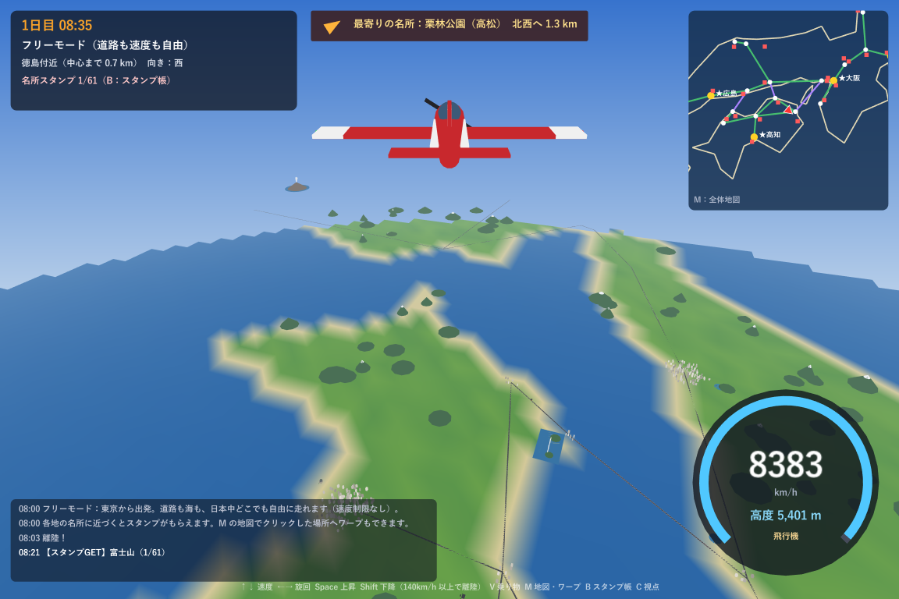
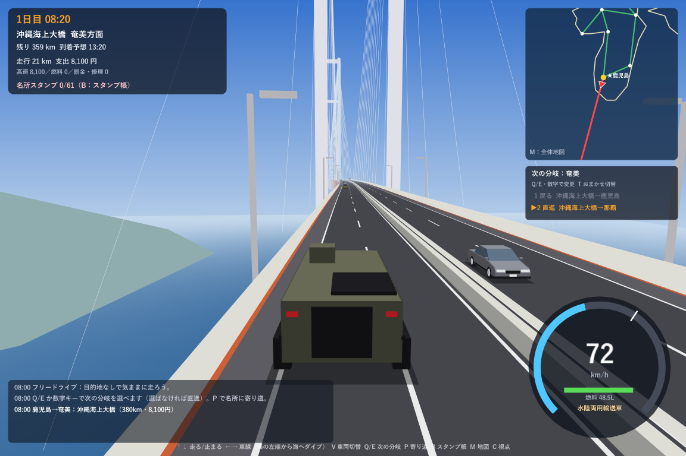
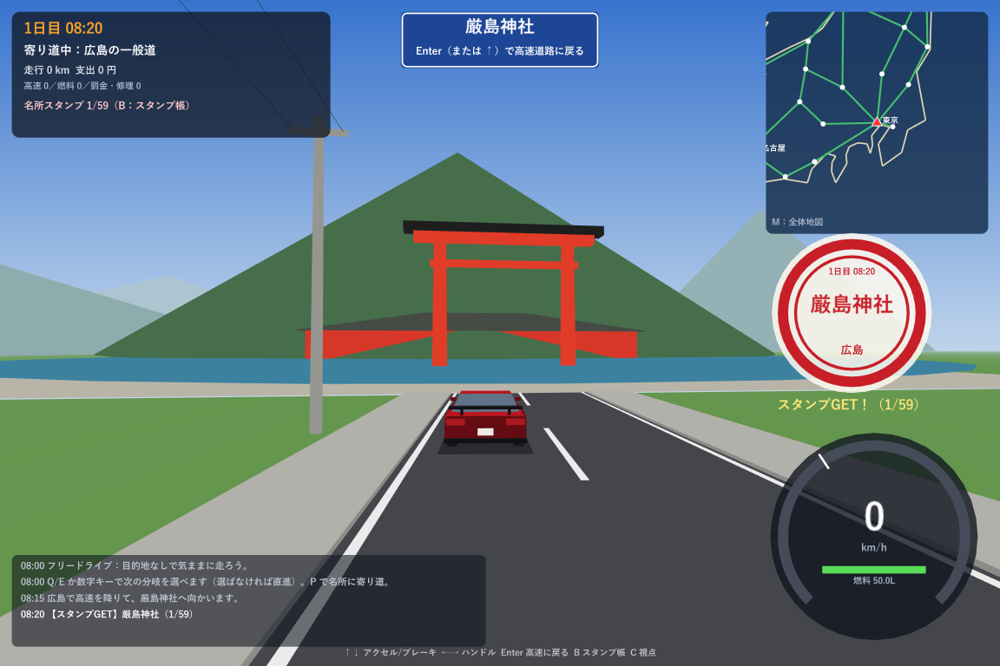

# 日本一周ドライブ 3D

日本の高速道路を走って日本一周したり、道路に関係なく日本中を自由に走り回ったりできる 3D ドライブゲームです（Windows 用・C#）。



## 遊び方

- **日本一周モード**：★の10都市を巡って東京へ戻る。分岐はおまかせで直進、Q/E で次の分岐を予約。高速料金・燃料・スピード違反もあり。
- **フリーモード**：道路も海も関係なく、日本中どこでも走れる。速度制限なし。地図をクリックしてワープも。
- **名所スタンプラリー**：全国61か所の名所（東京タワー、名古屋城、厳島神社、富士山、首里城…）を3Dで再現。近くまで行くとスタンプがもらえる。
- **乗り物**：スポーツカー、戦車（砲撃できる）、水陸両用輸送車、馬、飛脚、ヘリコプター、飛行機（フリーモード）。
- **沖縄海上大橋**：鹿児島〜奄美〜那覇をつなぐ全長680kmの超巨大橋（ゲームオリジナル）。
- 効果音・エンジン音・BGM はすべてプログラムで合成。記録は自動でセーブ。

| 沖縄海上大橋 | 名所スタンプ |
|---|---|
|  |  |

主な操作：↑↓ アクセル／ブレーキ、←→ ハンドル、V 乗り物切替、M 地図、B スタンプ帳、C 視点、F2/F3 BGM・効果音。詳しくはゲームに同梱の `遊び方.txt` を見てください。

## ダウンロード

**[最新版をダウンロード（JapanDrive3D-win-x64.zip）](https://github.com/Hayato-Akiduki/japan-drive-3d/releases/latest/download/JapanDrive3D-win-x64.zip)**

zip を右クリック →「すべて展開」し、中の `JapanDrive3D.exe` をダブルクリックで起動します（Windows 10/11 の 64bit 用、.NET のインストールは不要です）。過去のバージョンは [Releases](https://github.com/Hayato-Akiduki/japan-drive-3d/releases) にあります。

初回に「Windows によって PC が保護されました」と出たら、「詳細情報」→「実行」を押してください（署名のない自作アプリのため表示されます）。

## フォルダ構成

| フォルダ | 中身 |
|---|---|
| `JapanDrive3D/` | 3D 版（本体）。[Raylib-cs](https://github.com/ChrisDill/Raylib-cs) を使用 |
| `JapanDrive/` | 最初に作った 2D 版（WinForms）。地図データとゲームのルールは 3D 版と共通 |
| `docs/` | README 用の画像 |

## ビルド

.NET 10 SDK が必要です。

```bash
# 遊ぶ（開発中）
dotnet run --project JapanDrive3D

# 配布用の exe を作る（.NET 不要の単体 exe）
dotnet publish JapanDrive3D -c Release -r win-x64 --self-contained true -p:PublishSingleFile=true -p:IncludeNativeLibrariesForSelfExtract=true -p:DebugType=none -o 配布/日本一周ドライブ3D
```

リリース用の zip は `配布/日本一周ドライブ3D` フォルダを圧縮して作ります。
